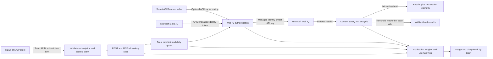

# APIM ❤️ Microsoft Web IQ

## [Microsoft Web IQ security, governance, and usage lab](web-iq.ipynb)

Route [Microsoft Web IQ](https://webiq.microsoft.ai/documentation/overview/) REST and [MCP](https://webiq.microsoft.ai/documentation/mcp/) through Azure API Management (APIM) with four implemented gateway features:

| Feature | What the lab implements |
| --- | --- |
| **Managed identity authentication to Web IQ** | APIM's system-assigned managed identity acquires the upstream Web IQ token by default. An optional API-key fallback is available for testing when the identity cannot be registered; it is not recommended for production. Clients send only their team subscription key. |
| **Content Safety for web results** | Analyze Hate, Sexual, Violence, and SelfHarm before returning REST or MCP content. Block scores at or above the configured threshold (default **4**); withhold content if analysis fails. |
| **Tool limitation: allow/deny Web IQ operations** | Apply configurable logical operation lists across REST and MCP. Deny takes precedence; default **allow `web`, deny `browse`**. Reject unknown tools, malformed messages, and JSON-RPC batches before forwarding. |
| **Usage throttling and telemetry for chargeback** | Share **60 requests/minute** and **1,000 tool operations/UTC day** per team across REST and MCP. Query gateway requests, outcomes, and latency by team; use custom metrics for upstream attempts, policy rejections, and moderation calls. |

Start with [web-iq.ipynb](web-iq.ipynb) to deploy and exercise all four features. The optional [Responses API notebook](web-iq-mcp-responses.ipynb) connects an existing Azure OpenAI deployment to the gateway's remote MCP endpoint. A ready-to-run [usage query by team](usage-by-team.kql) is included below and loaded directly by the main notebook.

### Architecture



APIM uses its system-assigned managed identity for Web IQ by default and for Content Safety in all cases. The optional Web IQ API-key fallback is for testing only and is not recommended for production. The deployment creates APIM, two team subscriptions, the Web IQ API/backend, Content Safety S0, Application Insights with dimensional metrics, and Log Analytics. Web IQ account access and the optional Azure OpenAI deployment are existing prerequisites.

### Prerequisites and setup

- Access to Web IQ, including Web Search and the MCP `web` tool. Register APIM's managed identity application client ID in Web IQ Profile Management, or use a Web IQ API key for testing if identity registration is unavailable.
- Python 3.12+, [uv](https://docs.astral.sh/uv/), and a Jupyter environment such as VS Code.
- Azure CLI authenticated to the intended subscription, with Contributor + RBAC Administrator, or Owner, for deployment.
- Regional availability for APIM **Basicv2** and Content Safety. Choose an APIM tier supporting `rate-limit-by-key` and `quota-by-key`; this configuration does not support the Consumption tier.

From the repository root:

```bash
uv sync
az login
az account set --subscription "<subscription-id>"
```

Open [web-iq.ipynb](web-iq.ipynb), select the repository `.venv` kernel, and run with `labs/web-iq` as the working directory. The root environment supplies requests, pandas, dotenv, Azure identity, OpenAI, and MCP dependencies. The notebook writes ignored `params.json`; keep optional `.env` configuration local and never commit credentials.

### Managed identity authentication to Web IQ

APIM subscriptions identify the consuming team; Web IQ authentication grants upstream service access. Clients always send `Ocp-Apim-Subscription-Key`. APIM validates it, derives the team from `context.Subscription.Id`, and removes that header and the `subscription-key` query parameter before forwarding. A client-supplied team header cannot change attribution or counters.

APIM authenticates to Web IQ with its system-assigned managed identity by default. Leave `use_web_iq_api_key_for_testing = False` in the notebook and leave the optional Bicep parameter `webIqApiKey` empty. Clients send only their team subscription key. APIM removes incoming `Authorization` and `x-apikey` headers and executes:

```xml
<authentication-managed-identity resource="https://api.microsoft.ai" />
```

After deployment, use output `apimManagedIdentityPrincipalId` to retrieve the identity's **application/client ID**:

```bash
az ad sp show --id "<apimManagedIdentityPrincipalId>" --query appId --output tsv
```

Bind the returned client ID in **Web IQ Profile Management before sending requests**. Your Web IQ account must support binding this managed identity. The object/principal ID itself is not the client ID. If directory read access prevents the CLI lookup, locate the managed identity's enterprise application in the Entra portal and copy its Application ID. The Content Safety RBAC assignment does not grant Web IQ access.

#### Optional API-key fallback — testing only

If you cannot register the managed identity with Web IQ, set `use_web_iq_api_key_for_testing = True` in the notebook. Supply `WEBIQ_API_KEY` in your local environment or enter the key at the masked prompt. **This fallback is for testing only and is not recommended for production.** Use managed identity for production deployments.

The notebook passes the key as the secure Bicep parameter `webIqApiKey`, using a temporary parameter file that is deleted after deployment. The regular `params.json` contains only non-secret settings. APIM stores the key in the secret named value `web-iq-api-key` and injects it into the upstream `x-apikey` header. Both REST and MCP clients continue to send only their team subscription key, and Content Safety continues to use managed identity.

To return to managed identity, set the notebook option to `False`, redeploy, and complete the Web IQ identity registration. For direct Bicep deployments, omit `webIqApiKey` or pass an empty value. An existing test named value is unused after switching back and can be removed from APIM.

### Deployment settings

The notebook defaults to resource group `lab-web-iq` in `westus2`, APIM `Basicv2`, API path `web-iq`, and subscriptions `research-team` / `support-team`. Their stable subscription IDs are the **Team** metric values, independent of display names and rotated keys.

| Bicep parameter | Default | Purpose |
| --- | --- | --- |
| `apimSku` | `Basicv2` | APIM tier supporting the policies. |
| `apimSubscriptionsConfig` | `[]` | Notebook supplies the two team subscriptions; direct deployments must supply these. |
| `webIqApiPath` | `web-iq` | Gateway API prefix. |
| `webIqServiceUrl` | `https://api.microsoft.ai/v3` | Web IQ upstream base URL. |
| `webIqApiKey` | Empty | Secure, optional API-key fallback for testing when identity registration is unavailable. Not recommended for production; empty uses managed identity. |
| `webIqAllowedOperations` | `['web']` | Logical operations permitted across REST and MCP. |
| `webIqDeniedOperations` | `['browse']` | Explicit deny list, evaluated with precedence over allow. |
| `webIqRequestsPerMinute` | `60` | Admitted HTTP requests/minute per team, including MCP protocol traffic. |
| `webIqDailyQuota` | `1000` | Admitted REST/tool operations per team per UTC day. |
| `contentSafetyBlockThreshold` | `4` | Block if any category is ≥ threshold. Allowed: 0, 2, 4, 6, or 8 (scores only). |
| `contentSafetyLocation` | Resource-group region | Region supporting Content Safety. |

Change the corresponding snake_case notebook settings and rerun deployment. `webIqServiceUrl` and `contentSafetyLocation` can also be supplied as Bicep parameters when needed. The template substitutes validated settings into both policy files. Deploy **main.bicep**, rather than uploading XML containing unresolved placeholders.

APIM, Content Safety, monitoring, Web IQ, and optional Azure OpenAI usage can incur charges. Each moderation chunk makes a separate Content Safety request. New managed-identity role assignments may take several minutes to propagate.

### Tool limitation: allow/deny Web IQ operations

Permissions are enforced by the gateway for every invocation. Valid logical names are `web`, `videos`, `news`, `images`, and `browse`. Only Web Search and Browse are published as REST operations in this lab; the other names govern MCP tools if your Web IQ account exposes them.

| Gateway endpoint | Operation ID | Permission / behavior |
| --- | --- | --- |
| `POST /web-iq/search/web` | `search-web` | Uses logical operation `web`. |
| `POST /web-iq/browse` | `browse-url` | Uses `browse`; denied by default. |
| `POST /web-iq/mcp` | `mcp-post` | `tools/call` uses exact `params.name`; checked against both lists. |
| `GET /web-iq/mcp` | `mcp-get` | Returns `405`; the optional long-lived stream is disabled for complete moderation. |
| `DELETE /web-iq/mcp` | `mcp-delete` | Forwards session termination. |

An operation must be in the allowlist **and absent from the denylist**. An empty allowlist denies every tool operation. For example, to enable Browse, set `webIqAllowedOperations=['web','browse']` and remove `browse` from `webIqDeniedOperations`, then redeploy. Adding it only to the allowlist leaves it denied.

Denied invocations return `403` with `errorCode: WebIqOperationBlocked` before Web IQ authentication or forwarding. The main notebook asserts this exact response for REST Browse, MCP Browse, and an unknown MCP tool. Malformed JSON, batches, and unsupported MCP methods return `400 InvalidMcpRequest`. The permitted protocol methods are `initialize`, `ping`, `tools/list`, `notifications/initialized`, and `notifications/cancelled`; they cannot invoke a tool and do not consume daily tool quota.

`tools/list` is forwarded unchanged, so denied tools can still appear in discovery. Model-side `allowed_tools` helps tool selection; APIM enforces permissions even when a client ignores that setting.

### Content Safety for web results

Every upstream response containing text is buffered and analyzed using `POST /contentsafety/text:analyze?api-version=2024-09-01`. APIM's system identity authenticates with audience `https://cognitiveservices.azure.com` and the **Cognitive Services User** role scoped to the deployed resource; local key authentication is disabled.

The policy extracts JSON string values, decodes JSON inside MCP tool text, and parses finite SSE data frames. It moderates plain text directly. Categories are **Hate, Sexual, Violence, SelfHarm**, with four severity levels: **0**, **2**, **4**, and **6**.

- **Below threshold:** preserve upstream results and add scores.
- **Any score ≥ threshold:** return `403 ContentSafetyBlocked`, with scores but without upstream content. The default threshold is **4**. Threshold **8** reports scores without blocking; **0** blocks every analyzed text response.
- **Incomplete/failed scan, oversized text, or unexpected compression:** return `502 ContentSafetyAnalysisFailed` without upstream content.
- **Empty/no-text responses:** return the original response with `no-text`; no moderation call is made.

Text is chunked into at most 10,000 UTF-16 units, preserving surrogate pairs, with 200-unit overlap and a maximum of 100,000 extracted units per response. All chunks must succeed; scores are the per-category maxima. This is text moderation, with no image moderation, custom blocklists, or Prompt Shields. Scores do not guarantee that content is safe.

REST responses include `contentSafety` with `status`, `scores`, `chunks`, `latencyMs`, and `requestId`. MCP results include it in `_meta`, structured content where present, and the first text content block. JSON-RPC errors receive `error.data.contentSafety`. Gateway blocks replace the payload with the gateway error and telemetry. Both notebooks display the four category scores without treating missing scores as zero.

| Response header | Meaning |
| --- | --- |
| `x-content-safety-status` | `analyzed`, `blocked`, `no-text`, `not-applicable`, `error`, `response-too-large`, or `unsupported-encoding`. |
| `x-content-safety-scores` | JSON category maxima after a complete analysis, including blocked results. |
| `x-content-safety-chunks` | Number of analysis calls attempted. |
| `x-content-safety-latency-ms` | Text extraction and moderation duration. |
| `x-apim-request-id` | Gateway correlation ID. |

Finite MCP POST/SSE results preserve framing and arrive after analysis. GET streams return `405` with `Allow: POST, DELETE`. Gateway permission, credential, and throttling failures report `not-applicable`; unexpected moderation errors report `error` and may lack chunk/latency headers.

### Usage throttling policies and telemetry for chargeback

`rate-limit-by-key` uses an API-and-team key across REST and MCP. It allows **60 admitted HTTP requests per minute** by default; excess traffic returns APIM's native **429** and `Retry-After`. `x-web-iq-rate-limit-remaining` exposes remaining capacity. Gateway limit errors include `x-web-iq-limit` (`RateLimitExceeded` or `QuotaExceeded`) to distinguish them from upstream errors. Protocol initialization/discovery/session traffic consumes this rate allowance.

`quota-by-key` uses a separate API-and-team counter allowing **1,000 admitted REST/tool operations per UTC day**. Excess usage returns APIM's native **403** and `Retry-After`. MCP protocol traffic is excluded. Local operation denials, malformed requests, invalid team subscriptions, and unsupported GET streams are rejected before these counters. Upstream errors and moderation-blocked results consume quota because the gateway already admitted their operation. Identity-token acquisition failures after quota admission can also consume quota.

Limits apply independently to each team; rotating a subscription key retains its team counter. Distributed rate/quota enforcement can overshoot, especially across gateway instances or restarts, so these limits are not exact billing meters or hard spending caps. The notebook includes an optional low-rate exercise; use a disposable lab for low-quota tests.

All metrics use namespace `web-iq` and at most five explicit dimensions. **Team** is always derived from the validated APIM subscription, never a request header. Other dimensions are `Operation ID`, bounded `MCP Tool`, `Authentication`, `Status Code`, `Limit`, or `Content Safety Status`, as applicable.

| Metric | Meaning |
| --- | --- |
| `Web IQ Requests` | Requests reaching inbound instrumentation, before local checks. Invalid APIM keys do not reach it. |
| `Web IQ Upstream Requests` | Forwarding attempts after local permission, credential, and limit checks, including MCP protocol requests. |
| `Web IQ Blocked Requests` | REST/MCP operation permission denials. |
| `Web IQ Throttled Requests` | Rate or daily quota rejections, with `Limit` distinguishing them. |
| `Web IQ Responses` / `Web IQ Latency` | Outbound responses and elapsed milliseconds, including moderation and the final client status. |
| `Web IQ Gateway Errors` | Executions of `on-error`, including rate/quota errors. |
| `Web IQ Content Safety Calls` | Individual moderation attempts, one per chunk, including failed attempts. |
| `Web IQ Content Safety Responses` / `Web IQ Content Safety Latency` | Moderation outcomes and analysis duration. |

Application Insights dimensional metrics are enabled and API diagnostic sampling is 100%. Body capture is zero bytes, header capture lists are empty, and API diagnostic client-IP logging is disabled. Custom dimensions contain no search text, target URLs, tokens, or keys. Notebooks display result data and deployment outputs include subscription keys; keep saved outputs local.

#### Sample query: track Web IQ usage by team

Open the deployed **API Management → Logs** or its **Log Analytics workspace → Logs** and run [usage-by-team.kql](usage-by-team.kql). The main notebook loads the same file and scopes its query to the deployed APIM resource. Each `ApiManagementGatewayLogs` row represents one HTTP request. `ApimSubscriptionId` supplies **Team** (`research-team`, `support-team`); `TenantId` identifies the Log Analytics workspace. Requests without a subscription ID are excluded from team allocation. Results also group by operation and APIM service so a workspace containing multiple gateways keeps them separate.

```kusto
// APIM > Logs or the connected Log Analytics workspace > Logs.
// Team is the APIM subscription ID; defaults are research-team and support-team.
ApiManagementGatewayLogs
| where TimeGenerated > ago(30d)
| where ApiId == 'web-iq-api'
// Requests without a validated subscription cannot be allocated to a team.
| where isnotempty(ApimSubscriptionId)
| extend Team = ApimSubscriptionId,
         ApimService = tostring(split(_ResourceId, '/')[-1])
// A recorded backend response does not establish provider-billed usage.
| extend HasBackendResponse = BackendResponseCode between (100 .. 599)
| summarize GatewayRequests = count(),
            SuccessfulRequests = countif(IsRequestSuccess == true),
            FailedRequests = countif(IsRequestSuccess == false),
            Responses401 = countif(ResponseCode == 401),
            Responses403 = countif(ResponseCode == 403),
            Responses429 = countif(ResponseCode == 429),
            BackendResponses = countif(HasBackendResponse),
            AverageLatencyMs = round(avg(TotalTime), 1),
            P95LatencyMs = percentile(TotalTime, 95),
            AverageBackendLatencyMs = round(avgif(BackendTime, HasBackendResponse), 1)
    by Team, OperationId, ApimService
| order by Team asc, GatewayRequests desc, ApimService asc, OperationId asc
```

- `GatewayRequests` counts logged requests, including local rejections and MCP protocol traffic. `SuccessfulRequests` and `FailedRequests` use APIM's `IsRequestSuccess` flag.
- `Responses401`, `Responses403`, and `Responses429` count final HTTP statuses. A `403` alone cannot distinguish operation denial, daily quota, moderation blocking, or an upstream rejection. `Responses429` does not include quota rejections returned as `403`.
- `BackendResponses` counts gateway requests with a recorded backend HTTP response, including upstream errors. It excludes requests with no recorded backend response and does not count individual retry attempts.
- Latencies are milliseconds: average and 95th-percentile total gateway time, plus average backend time for requests with a recorded backend response.

Use these counts for team traffic allocation and reconcile any cost estimates against provider billing. Gateway logs do not establish billable Web IQ transactions or distinguish MCP tool calls from initialization/discovery messages sharing `mcp-post`. They also do not count Content Safety analysis calls. Use the separate Application Insights custom metrics above for MCP tool, policy rejection, and moderation details; allocate fixed APIM/monitoring costs separately.

The notebook sends the usage query to the Azure Monitor resource query endpoint scoped to APIM. Its separate latency and Content Safety metric queries remain scoped to Application Insights and use `customMetrics`. Both the usage query and API timespan cover 30 days; update both when changing that range. Gateway logs can take several minutes to arrive. Web IQ citation/click [instrumentation](https://webiq.microsoft.ai/documentation/instrumentation/) is separate from gateway usage metering.

### Azure OpenAI Responses API MCP test flow

After deploying the lab, open [web-iq-mcp-responses.ipynb](web-iq-mcp-responses.ipynb). Configure:

```dotenv
AZURE_OPENAI_CONNECTION_STRING="Endpoint=https://<resource>.openai.azure.com;Deployment=<deployment-name>"
WEB_IQ_MCP_CONNECTION_STRING="Endpoint=https://<apim-name>.azure-api.net/web-iq/mcp;Ocp-Apim-Subscription-Key=<team-subscription-key>"
```

The MCP connection string supplies the gateway endpoint and team subscription key. APIM uses managed identity by default or the optional test-only API-key fallback configured during deployment. Complete that setup before invoking the tool; the MCP notebook does not need the Web IQ API key. The fallback is not recommended for production. The notebook's Azure OpenAI identity is separate from APIM's Web IQ authentication.

The existing Azure OpenAI deployment must support Responses and remote MCP, and the notebook identity needs **Cognitive Services OpenAI User**. The Azure OpenAI service connects to APIM, so the MCP endpoint must be publicly reachable over HTTPS. The notebook uses the configured deployment name, invokes `web`, and reads actual MCP tool output to display Content Safety telemetry. It verifies Browse enforcement with a direct gateway request and asserts the specific policy error.

### Folder contents

| File | Purpose |
| --- | --- |
| [web-iq.ipynb](web-iq.ipynb) | Deploy and exercise authentication, moderation, permissions, throttling, and usage queries. |
| [web-iq-mcp-responses.ipynb](web-iq-mcp-responses.ipynb) | Connect an Azure OpenAI deployment to the governed MCP endpoint. |
| [main.bicep](main.bicep) | Deploy resources, RBAC, policy settings, and diagnostics. |
| [policy.xml](policy.xml) | Authentication, REST/MCP operation permissions, team counters, and metrics. |
| [content-safety-outbound.xml](content-safety-outbound.xml) | Buffer, analyze, block, and annotate web results. |
| [content_safety_helper.py](content_safety_helper.py) | Read moderation telemetry from REST and MCP results. |
| [usage-by-team.kql](usage-by-team.kql) | Gateway log request counts, outcomes, and latency by team and operation. |
| [openapi.json](openapi.json) | Stable REST and MCP operation IDs and gateway responses. |
| [clean-up-resources.ipynb](clean-up-resources.ipynb) | Remove the lab resource group. |

The notebook's request assertions validate the deployed gateway; they require Azure and Web IQ access.

### Troubleshooting and cleanup

| Symptom | Check |
| --- | --- |
| Import errors | Run root `uv sync`, choose its `.venv` kernel, and run from `labs/web-iq`. |
| Web IQ `401` | With managed identity, verify APIM's application ID is bound in Web IQ Profile Management and the token audience is `https://api.microsoft.ai`. With the test-only fallback, verify the key stored in the secret named value `web-iq-api-key` is valid. |
| Gateway `401` | Supply a valid team APIM subscription key. |
| `403 WebIqOperationBlocked` | Check both permission lists. Discovery can advertise denied tools. |
| `400 InvalidMcpRequest` | Send one valid JSON-RPC 2.0 message using a supported method and exact tool name. |
| `429`, or quota `403` with `Retry-After` | Respect the retry interval; inspect `Web IQ Throttled Requests` by Team and Limit. |
| `403 ContentSafetyBlocked` | Web results reached the configured threshold; inspect returned category scores. |
| `502 ContentSafetyAnalysisFailed` | Check Content Safety region, resource quota, identity RBAC propagation, and response size. |
| Empty usage table | Allow ingestion time; verify APIM gateway diagnostic logs reach `ApiManagementGatewayLogs` in the connected workspace, then check the APIM resource scope, time range, `ApiId`, and `ApimSubscriptionId`. |

Run [clean-up-resources.ipynb](clean-up-resources.ipynb) after completing the lab to delete its resource group.
